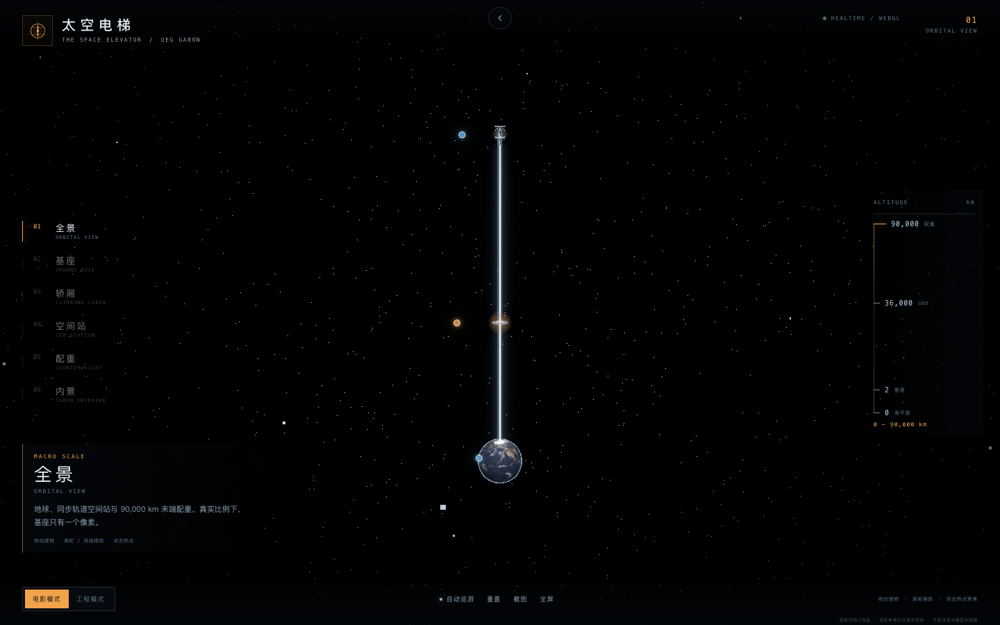
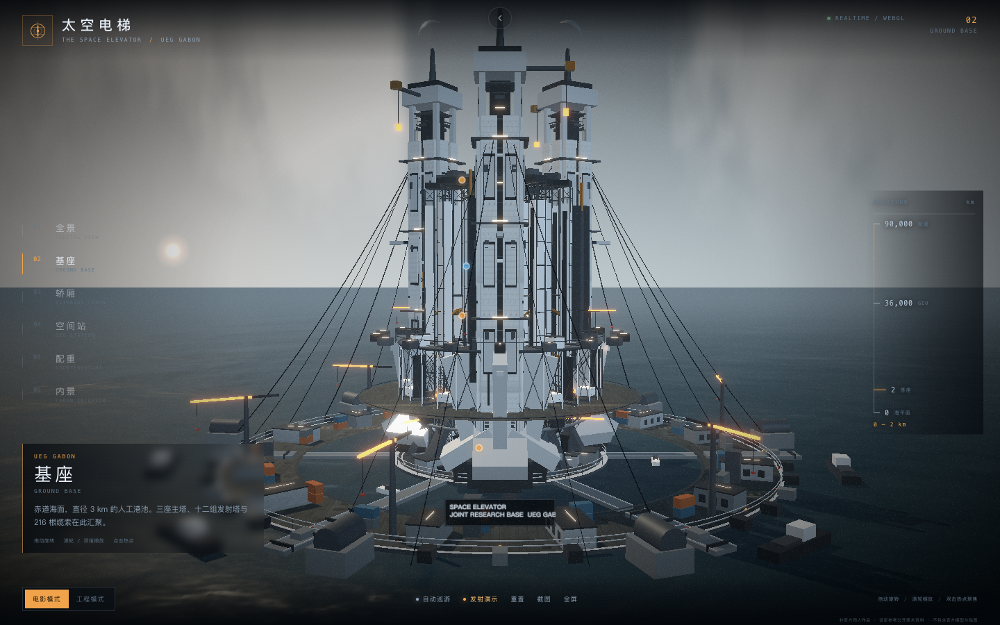
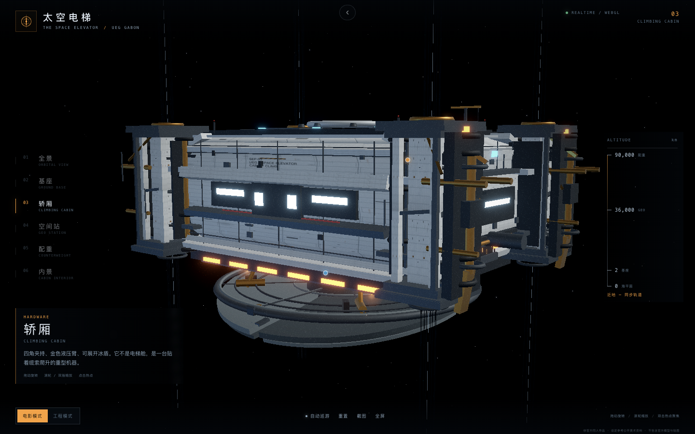
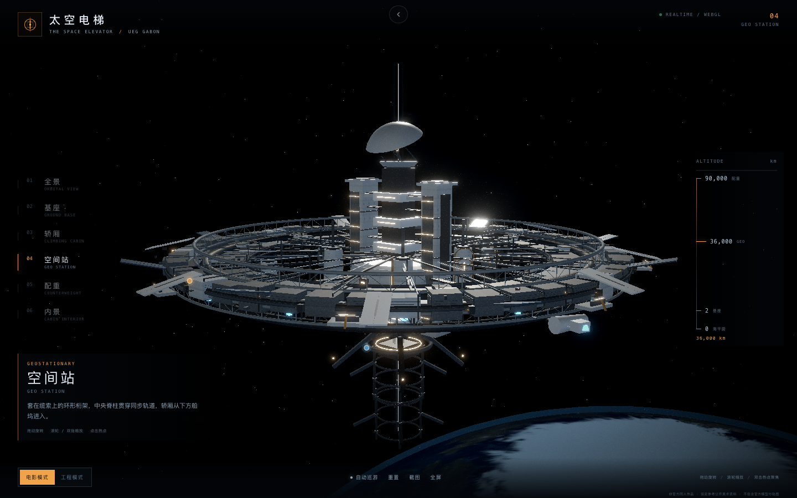
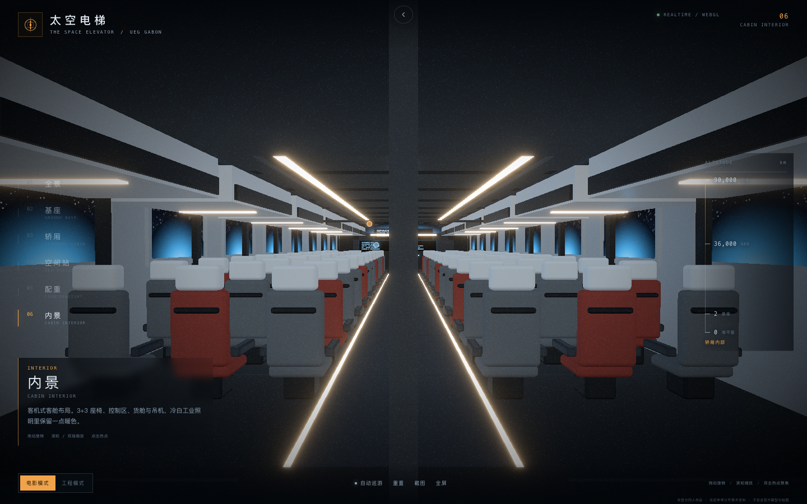

# 太空电梯 · THE SPACE ELEVATOR

《流浪地球2》太空电梯的交互式 Web 3D 同人重建。

> 本项目是「同一 Prompt × 不同 Agent+Model」实验合集的成员之一。
> 实验环境：**DeepSeek Harness + DeepSeek V4.1 Flash 1017**。合集首页位于仓库根目录。

## 效果预览

六个视图层级（从 90,000 km 末端配重到轿厢内景），另有结构剪影原型 [`blockout.html`](blockout.html)：

| 全景（真实尺度） | 基座 · 三主塔与港池 |
| :---: | :---: |
|  |  |
| **轿厢 · 四角夹持单元** | **空间站 · 环形桁架** |
|  |  |
| **内景 · 客舱过道** | |
|  | |

从赤道海面 3 km 基座，到 36,000 km 的 GEO 空间站，再到 90,000 km 末端配重；包含三主塔、十二组发射塔、216 根缆索、九部轿厢和轿厢内景。

> 非官方同人作品，仅用于学习与展示。不包含官方模型、官方贴图或官方 Logo。设定参考官方公开美术资料。

## 截图

合集构建后可通过 `npm run thumbs` 统一重新生成各项目的展示截图；运行合集后可直接进入本项目体验基座、轿厢、内景、空间站、配重、全景与发射演示等视图。

## 结构审查

当前模型与官方美术设定在结构/比例上的差距审查、以及首轮结构重构记录见 [`docs/模型结构与比例审查.md`](docs/模型结构与比例审查.md)。

第二轮重构后的复查、具体差距和下一轮计划见 [`docs/差距复查-第二轮.md`](docs/差距复查-第二轮.md)。

自我迭代记录见 [`docs/iterations/round-01.md`](docs/iterations/round-01.md)。

Round 02 记录见 [`docs/iterations/round-02.md`](docs/iterations/round-02.md)。

Round 03 记录见 [`docs/iterations/round-03.md`](docs/iterations/round-03.md)。

Round 04 记录见 [`docs/iterations/round-04.md`](docs/iterations/round-04.md)。

Round 05 记录见 [`docs/iterations/round-05.md`](docs/iterations/round-05.md)。

Round 06 记录见 [`docs/iterations/round-06.md`](docs/iterations/round-06.md)。

Round 07 记录见 [`docs/iterations/round-07.md`](docs/iterations/round-07.md)。

Round 08 记录见 [`docs/iterations/round-08.md`](docs/iterations/round-08.md)。

Round 09 记录见 [`docs/iterations/round-09.md`](docs/iterations/round-09.md)。

最终评估（Round 10）见 [`docs/iterations/final-assessment.md`](docs/iterations/final-assessment.md)。

参考 Op55/GPT 后的 3 轮针对性重构见 [`docs/iterations/round-10-12.md`](docs/iterations/round-10-12.md)。

结构 blockout 原型（只验证剪影/比例，不贴图）：[`blockout.html`](blockout.html)

## 运行

本项目已并入实验合集，统一使用 npm，由合集根目录的构建脚本统一安装、构建与部署：

```bash
# 在合集根目录执行
npm run install:all   # 为全部子项目安装依赖
npm run build         # 构建全部子项目并汇总到根 dist/
npm run serve         # 本地预览整个合集
```

单独开发本项目：

```bash
npm install
npm run dev           # http://127.0.0.1:5173
npm run build
npm run preview
```

## 功能

- **六个视图层级**：全景 / 基座 / 轿厢 / 空间站 / 配重 / 内景
- **v2 细节增强**：程序化工业面板、法线/粗糙度细节、铆钉、散热格栅、greeble、环梁步道、缆索锚点、塔顶吊机、空间站天线与穿梭机
- **v3 细节增强**：主塔基座/顶部冠部/外部立柱/UEG 编号、发射台危险环、轿厢冰盾裂纹与核心、空间站中央舱段、程序化云层、地平线暖光与冷暖色彩分级
- **结构比例重构**：参考 Op55/GPT 后重新收紧：三塔 450 m 半径、主塔 168 m 宽、主环 480 m、低机位；轿厢改 loft 截面；空间站环改开放分段甲板
- **发射演示**：基座视图点击「发射演示」，12 秒完成点火、爬升、入轨镜头；带 HUD 进度与取消
- **自由视角**：鼠标拖动、滚轮、触屏单指旋转、双指捏合缩放
- **电影模式 / 工程模式**：电影模式有海雾、暖光、Bloom 与暗角；工程模式关雾、显示网格与部件热点
- **热点信息卡**：主塔、发射塔、中央井、轿厢、冰盾、空间站、配重、客舱、控制区、货舱
- **电影镜头预设**：每个层级有独立机位，切换时黑场过渡
- **自动巡游**：按基座 → 轿厢 → 内景 → 空间站 → 配重 → 全景顺序飞行
- **移动端竖屏**：底部 6 项层级导航、侧向适配相机、底部抽屉信息卡、手势操作
- **截图 / 全屏 / 重置**
- **URL 直达**：`?view=base&intro=0&mode=engineering`

## 操作

| 操作 | 桌面 | 移动端 |
|---|---|---|
| 旋转 | 左键拖动 | 单指拖动 |
| 缩放 | 滚轮 | 双指捏合 |
| 平移 | 右键拖动 | 双指拖动 |
| 聚焦 | 点击热点 | 点击热点 |
| 重置 | `R` | 底部「重置」 |
| 切换模式 | `M` | 底部模式开关 |
| 层级直达 | `1`–`6` | 底部导航 |
| 自动巡游 | 空格 | 底部「自动巡游」 |

## 技术栈

- Vite 5 + TypeScript
- React 18 + React Three Fiber 8
- `@react-three/drei`：CameraControls、Html、Line、Stars、RoundedBox
- `@react-three/postprocessing`：Bloom、Vignette、Noise
- Zustand：场景层级、模式、热点、转场状态
- 纯程序化几何 + 模块化 kit；未使用外部 GLB

## 目录

```text
src/
├── App.tsx                     # Canvas + HUD + 转场 + 自动巡游
├── scene/
│   ├── Experience.tsx          # 渲染器配置、环境贴图、纹理预加载
│   ├── CameraRig.tsx           # 层级机位、移动端竖屏适配
│   ├── SceneContent.tsx        # 层级路由
│   ├── Effects.tsx             # Bloom / Vignette / Noise
│   ├── layers/                 # 轨道、基座、配重
│   └── parts/                  # 地球、空间站、轿厢、内景、基座部件
├── ui/                         # HUD、Intro、Loading、InfoPanel
├── state/useSceneStore.ts      # 场景状态
├── data/specs.ts               # 层级、机位、热点、设定文案
└── styles.css                  # HUD / 移动端 / 转场样式
```

## 尺度设计

不采用单场景 1:1 连续缩放，而是分层：

| 层级 | 比例 | 内容 |
|---|---|---|
| L0 轨道 | 1 unit = 1,000 km | 地球、90,000 km 缆索、空间站、配重 |
| L1 基座 | 1 unit = 10 m | 3 km 港池、三主塔、12 组发射塔、9 轿厢 |
| L2 轿厢 | 1 unit = 0.1 m | 四角夹持、冰盾、推进器、对接结构 |
| L3 空间站 / 配重 | 1 unit = 1 m | 环形站、船坞、配重模块 |
| L4 内景 | 1 unit = 0.1 m | 客舱、控制区、货舱 |

真实比例下，3 km 基座在 90,000 km 视野里不到 0.03 px，所以 L0 用发光标记代替基座细节，层与层之间用黑场过渡，而不是强行连续缩放。

## 资产与版权

- 地球纹理来自 Three.js 官方示例的 NASA/公有领域纹理；水面法线来自 Three.js 示例。
- 所有几何体均为程序化生成，未使用电影官方模型或贴图。
- 设定数据参考官方公开美术设定报道：
  - 新华网《流浪地球2》的太空电梯如何搭建？美术设定集曝光
  - 7.GAME / 搜狐《官方新解禁！〈流浪地球2〉设定集要来了？》
  - 网易 / CG世界《〈流浪地球2〉“太空电梯”超详细美术设定》
- 研究资料与版权说明见 [`docs/reference/README.md`](docs/reference/README.md)。

## 开发约定

后续开发、代码约定、性能预算与 Pages 部署细节见 [AGENTS.md](AGENTS.md)。

## 已知限制

- 这是风格化同人近似重建，不是 1:1 数字孪生；已加入程序化面板、greeble、环梁步道、缆索锚点、塔顶吊机、空间站天线与穿梭机，但近景细节仍与官方高模有差距。
- 程序化几何在近景细节上不如手工高模；后续可以安装 Blender，用 GLB 替换主塔、轿厢、空间站等 hero 部件。
- 移动端为了保证 30 fps，会限制 DPR，并在工程模式下关闭部分后期。
- 尚未加入音效、轿厢内部第一人称走动、发射流程时间轴。
