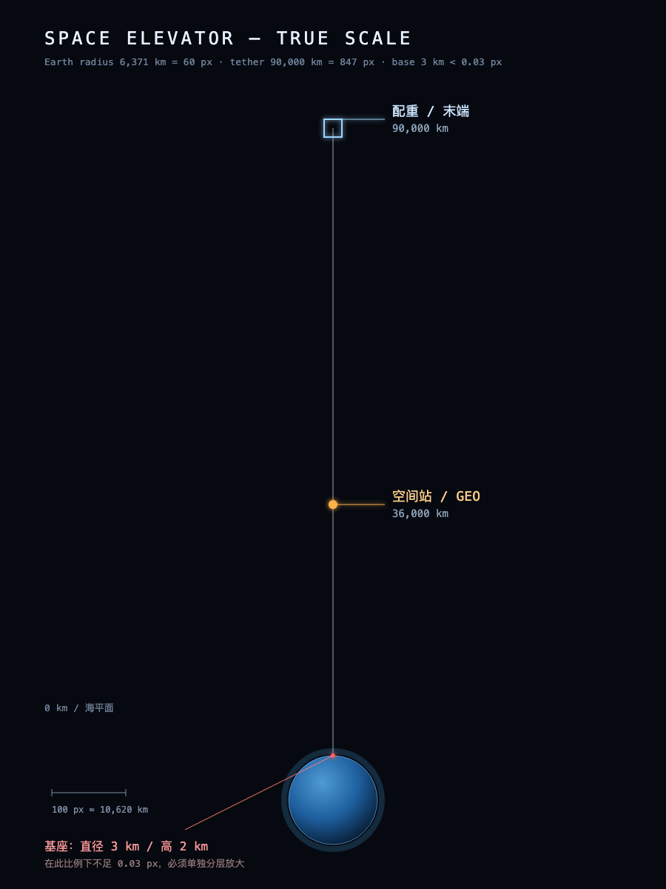
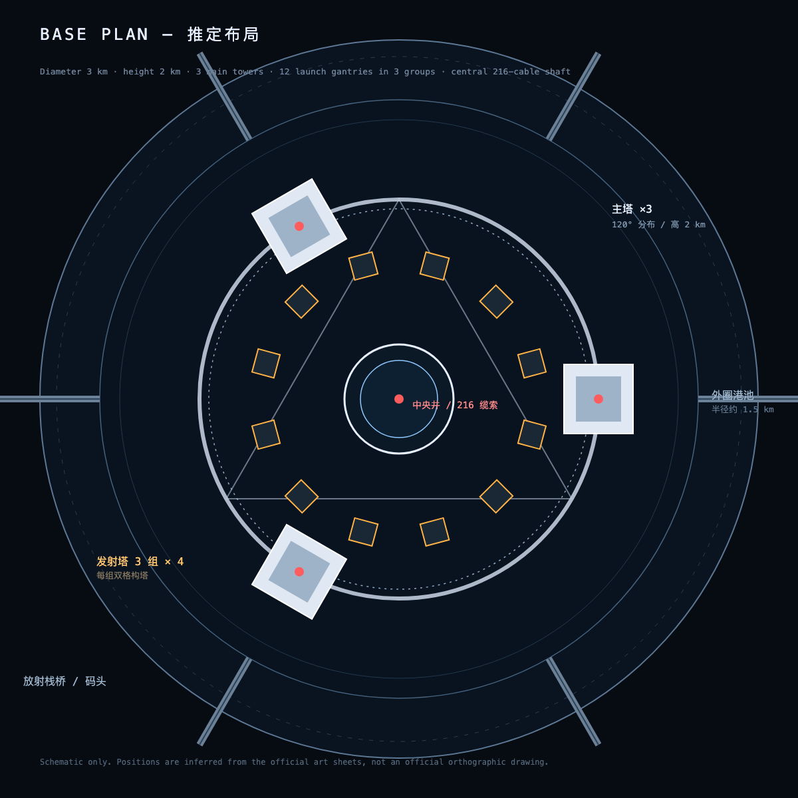

# 《流浪地球2》太空电梯设定拆解

> 目的：把公开的官方美术设定转成可执行的 Web 3D 还原规格。
>
> 资料边界：官方 2023 年 2 月公开发布的美术设定图与报道，不含付费设定集扫描件，也不含官方 3D 模型。文中标“推定”的是根据透视图和比例关系反推的建模建议，不是官方尺寸。
>
> 版权说明：官方设定原图保存在 [`docs/reference/`](reference/README.md)，仅用于研究与视觉参考；版权归原权利人所有，请勿用于商业用途或再次分发。比例图与基座推定布局为本项目原创示意图。

## 0. 一句话结论

电影里的太空电梯不是“一根绳子挂一个电梯”，而是：

**3 座约 2 km 高的海上主塔 + 12 组发射塔 + 216 根碳纳米缆索 + 9 部矩形轿厢 + 36,000 km GEO 空间站 + 90,000 km 末端配重**。

还原时最值得抓的是四件事：

1. 三主塔、环梁、拉索和圆形港池组成的**海上基座剪影**；
2. 四角夹持、带冰盾的**矩形轿厢**；
3. 套在缆索上的**环形 GEO 空间站**；
4. 贯穿 14 个地球半径、在远景里几乎不可见的**缆索尺度感**。

## 1. 总体参数

| 项目 | 设定 | 对建模的意义 |
|---|---|---|
| 总高 | 90,000 km | 约 14.1 个地球半径；必须分层渲染 |
| 空间站 | 距地表 36,000 km，地球同步轨道 | 约 5.6 个地球半径；缆索中段的重要视觉锚点 |
| 配重 | 90,000 km 末端 | 缆索终点，远景中的小十字/花环 |
| 基座 | 直径 3 km、高 2 km | 海上巨型平台；在 9 万 km 视野里小于 0.03 px |
| 基座构成 | 3 根主塔、12 组发射塔、圆形发射平台 | 三塔 + 环梁 + 拉索是剪影核心 |
| 位置 | 赤道海面；标识为“UEG GABON” | 加蓬近海，背景可见行星发动机 |
| 轿厢 | 9 部；单部运力约为现役最大火箭的 4 倍 | 矩形升降平台，不是传统电梯轿厢 |
| 缆索 | 216 根粗细不等的碳纳米缆绳 | 远景是线束，近景是 4 组夹持 |
| 冰盾 | 轿厢底部可展开的冰质防热盾 | 返回大气层的关键动画 |

这张图按真实比例画：地球半径 6,371 km，缆绳 90,000 km，基座 3 km。基座在这个比例下不到 0.03 px——这就是为什么不能用一个场景从轨道一路缩放到基座。

设定数据来源：新华网、7.GAME/搜狐、网易/CG世界的官方美术设定公开报道，详见 [`reference/README.md`](reference/README.md)。

## 2. 地面端基座

### 2.1 总平面

从俯视图和航拍图可以读出三层同心关系：

- **外圈**：圆形人工港池/防波堤，外面有放射状栈桥、码头、道路和保障区；
- **中圈**：三角形布置的三座主塔，塔间由下部环形桁架连接；
- **内圈**：中央电梯井，216 根缆索在这里汇聚并向上；井口周围是圆形发射平台。

三座主塔之间还有大量斜拉索，从塔顶/塔身拉到外圈港池的锚点，形成“张拉整体”的视觉。这个索网是基座轮廓的灵魂，不能省。

> 上图为按官方文字和透视图推定的布局，不是官方正交图：外圈港池、三座 120° 主塔、12 组发射塔（3 组 × 4）、中央 216 缆索井。

### 2.2 三主塔

- 三座塔约呈 120° 分布，白色/浅灰的巨型竖向体量，表面有密集的竖向肋、凹槽、维护平台和管线。
- 每座塔内部有电梯井/设备井，剖面图里能看到多层维护平台和轨道。
- 塔身中下部由一圈粗壮的环形桁架连接，环形桁架同时是发射平台/登乘区的结构支撑。
- 塔顶有向外伸出的缆索连接臂和顶部机械平台；三塔共同约束中央缆索束。
- 塔基向外伸出斜撑，落到港池边缘；整体像一座“海上张拉塔”。

### 2.3 十二组发射塔

官方文字是“十二组发射塔，均分三组”。从发射照片看，一组发射位由**两座深色格构式发射塔 + 中间轿厢 + 两侧硬质连杆/助推臂**组成：

- 发射塔是深色钢桁架，和白色主塔形成强对比；
- 轿厢在中间，四台发动机向下喷出四道白色/橙色尾焰；
- 发射塔本身是大型助推器，硬质连杆先对接轿厢，点火后像抛石机一样给轿厢叠加初速度；
- 平台周围有大量蒸汽、管线、格栅、轨道和警示色。

建模建议：3 组 × 4 个发射位，共 12 组；每组 2 座格构塔，围绕中央井口布置。这个数量关系符合“12 组、均分 3 组”的文字，也能还原照片里的双塔夹轿厢构图。

### 2.4 港池、海面与环境

- 基座位于赤道海面，内部有一个圆形港池，海水颜色偏深青/灰蓝。
- 外圈有环形堤、放射状栈桥、码头、吊机、仓库、道路和车辆；这些是尺度参照物。
- 海面有雾、蒸汽、浪花和低云；远景常常把塔顶切出画面，强化“高得看不见顶”。
- 部分官方图里，基座背后能看到巨大的加蓬行星发动机轮廓。这个背景元素非常“流浪地球”，建议作为远景剪影加入。

### 2.5 尺度线索

基座直径 3 km、高 2 km，意味着：

- 一艘几十米的船在基座前只有几个像素；
- 一栋 100 m 的楼不到主塔高度的 1/20；
- 发射塔本身有“城市级”高度；
- 在远景里，真正可读的是三塔的竖向线条、环梁、索网和港池的圆环。

建模时一定要放船、吊机、车辆、栈桥、栏杆等小物件，否则会失去电影里的压迫感。

## 3. 缆索

- 9 部轿厢由 216 根粗细不等的碳纳米缆绳连接。
- 在基座，缆索汇聚到中央井；在轿厢，缆索分成四组，从四个角的夹持机构穿过；在空间站，缆索从环形结构中心穿过；在配重，缆索终止于末端结构。
- 远景里它不是一根粗绳，而是一束近乎平行的细线，局部有轻微张拉曲线和摆动。
- 近景里能看到缆索的金属接头、夹块、导向轮、液压臂和红色/蓝色标记。

还原策略：

- L0 轨道层：一根屏幕空间亮线/极细 ribbon，加 bloom，必要时用 shader 画多股条纹；
- L1 基座层：中央井附近用 4 组线束，远处渐隐，避免画满 90,000 km；
- L2 轿厢层：四角夹持机构用真实几何，缆索用实例化圆管，只保留相机附近几十米。

## 4. 轿厢

### 4.1 总体造型

第一眼像“建筑工地的垂直升降机”，但被做成了航天器级别的硬表面：

- 主体是**扁矩形平台**，宽度明显大于高度；
- 四角各有一个大型夹持/导向塔，围着缆索束；
- 顶部是一整块深色矩形面板（像散热/太阳能/防护盖），周围有白色装甲板和蓝色圆形检修盖；
- 侧面有设备舱、舷窗、管线、红色警示条和编号；
- 下部有发动机、货舱门、逃逸滑板、对接结构；
- 四角夹持塔上有金色/黄铜色的液压连杆和白色滚轮/夹块，是整台机器最醒目的机械细节。

### 4.2 关键部件

| 部件 | 形态 | 建模要点 |
|---|---|---|
| 四角夹持塔 | 白色矩形立柱 + 金色液压臂 + 黑色滚轮/夹块 | 每角一组，夹住缆索束；金色是视觉重点 |
| 顶部深色面板 | 大块深灰/黑色矩形，分缝 | 不要做成纯黑，要有微弱反射和面板线 |
| 蓝色圆形盖 | 顶部若干蓝色小圆盖 | 增加“航天器”感，少量即可 |
| 冰盾 | 底部可展开的多瓣/分段圆盘 | 收起时贴合底部，展开时像花瓣/浅碟 |
| 推进器 | 底部/侧面喷口 | 发射时四道尾焰，颜色偏白/橙 |
| 对接结构 | 顶部吸盘连接处、空间站对接接口、引擎固定卡扣 | 与空间站底部对接框架对应 |
| 逃逸滑板 | 侧面可展开的滑板/梯 | 增加故事性细节，可选 |

### 4.3 尺寸建议

官方没有给轿厢具体尺寸，只给了“运力是现役最大火箭的 4 倍”。按图中与缆索、发射塔的比例，建模时可以先把主体定在**数十米级**（例如 35–50 m 宽、20–30 m 高，含四角夹持塔再放大），再根据 L2 镜头调整。重点不是绝对尺寸，而是“宽扁主体 + 四角高塔 + 底部冰盾”的比例关系。

## 5. 空间站

空间站位于 36,000 km 的 GEO，是套在缆索上的环形结构：

- 一个巨大的**环形桁架**，带放射状辐条和外围设备；
- 中央有纵向脊柱，缆索从中间穿过；
- 环的下方有对接船坞/捕获框架，轿厢从下方进入；
- 外围有太阳能板、散热板、推进器和停靠的飞船；
- 电影里的空间站还在建造/扩展，所以有脚手架、临时结构和工程船。

建模建议：环形结构用“主环 + 辐条 + 外围模块 + 中央脊柱”四层；环的直径可以做得很大（数公里级），这样从远处看是一个明显的圆环，从近处看又能提供大量桁架细节。

## 6. 配重

配重在 90,000 km 末端，造型像一组围绕缆索的工业模块：

- 中央是纵向的粗壮脊柱/桁架；
- 外围有放射状支架、设备舱、太阳能/散热板；
- 顶部有平坦的平台/对接面；
- 官方给了三种方案，整体都偏“重型机械 + 太空工业”，不是光滑的科幻造型。

在 L0 远景里，它只需要读成缆索末端的一个小十字/花环；在 L3 近景里再展示细节。

## 7. 电影视觉语言

### 7.1 色彩

| 场景 | 主色 | 点缀 | 光线 |
|---|---|---|---|
| 基座/海面 | 灰蓝、冷白、深青 | 暖橙警示条、黄色吊机、白色蒸汽 | 阴天/晨昏，低对比，体积雾 |
| 发射 | 白、橙、黑 | 红色警示、蓝色设备灯 | 强烈尾焰，蒸汽被照成暖色 |
| 轨道 | 黑、冷灰、地球蓝 | 空间站暖白窗光、蓝色推进器 | 硬太阳光，高对比，地球反光 |
| 轿厢内部 | 冷白、浅灰 | 红色座椅、黄色标签 | 均匀工业照明 |

### 7.2 镜头

- 基座：低机位、广角、仰拍，塔顶出画；前景放船/吊机/人，强化尺度。
- 缆索：从轿厢边缘向上仰拍，216 根线汇聚到灭点；或从轨道俯拍，缆索像一根细线插进地球。
- 空间站：从下方仰拍环形结构，轿厢从画面下方升起；或从侧面平视，环+脊柱形成十字。
- 配重：远景小十字，近景工业细节。
- 电影感来源：长焦压缩、浅景深、镜头光晕、体积雾、慢速推拉，而不是单纯堆模型。

### 7.3 运动

- 缆索轻微摆动/张力变化；
- 海面波浪、蒸汽、云层缓慢移动；
- 轿厢沿缆索爬升，经过时带动导向轮/液压臂微动；
- 空间站缓慢自转/太阳能板转动；
- 地球自转、云层移动、城市灯光；
- 发射时四道尾焰 + 蒸汽爆发 + 镜头震动。

## 8. 还原优先级

| 优先级 | 内容 | 原因 |
|---|---|---|
| P0 | 三主塔、环梁、索网、圆形港池、四角轿厢、GEO 环站、90,000 km 缆索 | 决定“像不像” |
| P1 | 12 组发射塔、冰盾、四角夹持、对接船坞、配重 | 决定“细节可信度” |
| P2 | 管线、栏杆、梯子、警示条、天线、灯具、编号 | 决定“电影质感” |
| P3 | 加蓬行星发动机、港区城市、船、吊机、云/雾 | 决定“世界观” |
| P4 | 轿厢内部（客舱/控制室/货舱） | 可选，工作量大，适合后续扩展 |

## 9. 必须做的“视觉欺骗”

1. **基座在轨道层不可见**：L0 用发光标记/光点代替，不能强行画 3 km 细节。
2. **缆索在远景是亚像素**：必须用屏幕空间线宽或 shader 条纹，不能依赖真实圆柱。
3. **轿厢在 GEO 尺度是亚像素**：L0 用移动光点，L1/L2 才出现几何。
4. **空间站/配重的细节按距离分级**：L0 看轮廓，L3 看桁架。
5. **雾和蒸汽是尺度的一部分**：基座没有雾会显得像玩具。

## 10. 资料缺口与下一步

- 没有正交三视图，无法精确量尺寸；建模以文字尺寸 + 透视图比例为准。
- 没有官方 3D 模型/贴图；需要原创重建。
- 公开图分辨率有限，近景 greeble 需要合理创作，不能声称 1:1。
- 如果之后能拿到官方设定集或 4K 原图，优先补充：基座平面、主塔剖面、轿厢四视图、空间站正视图。

下一步见 [`太空电梯-还原方案.md`](太空电梯-还原方案.md)。
