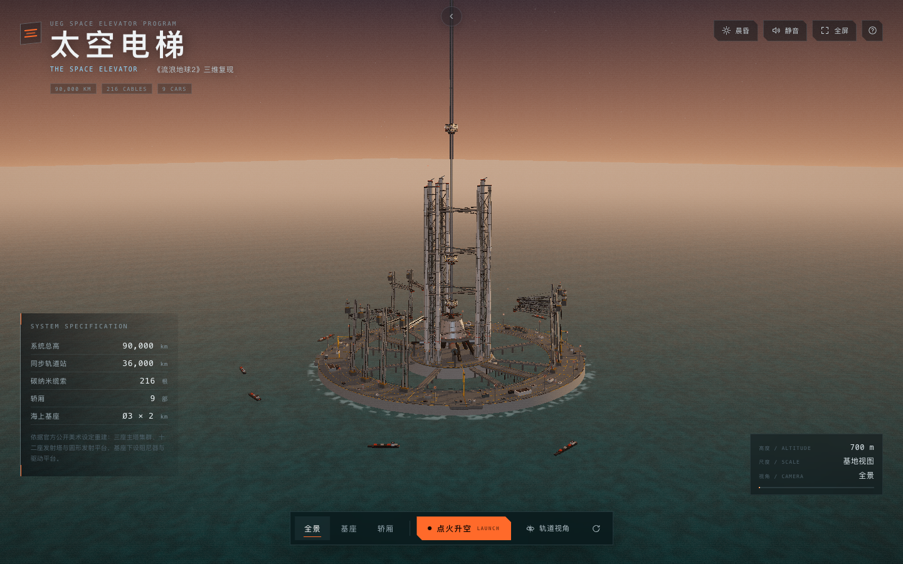
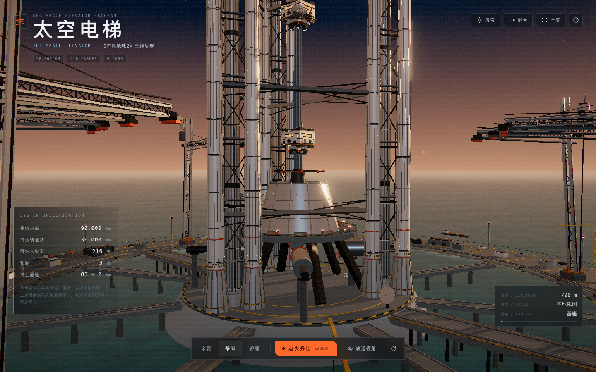
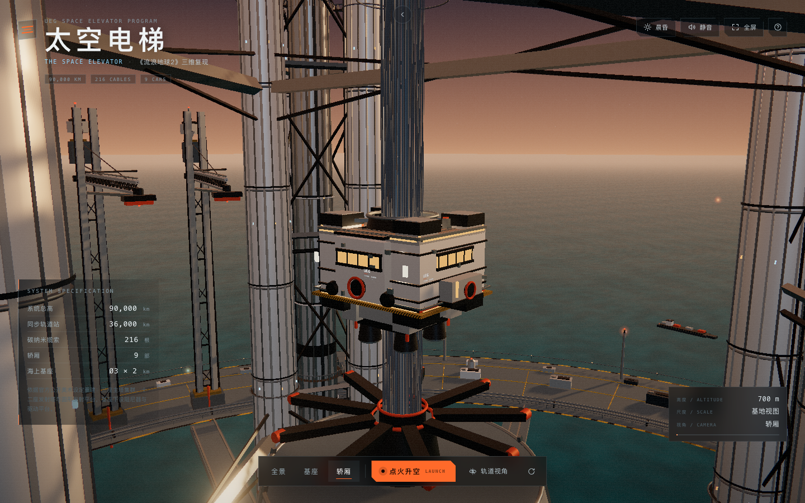
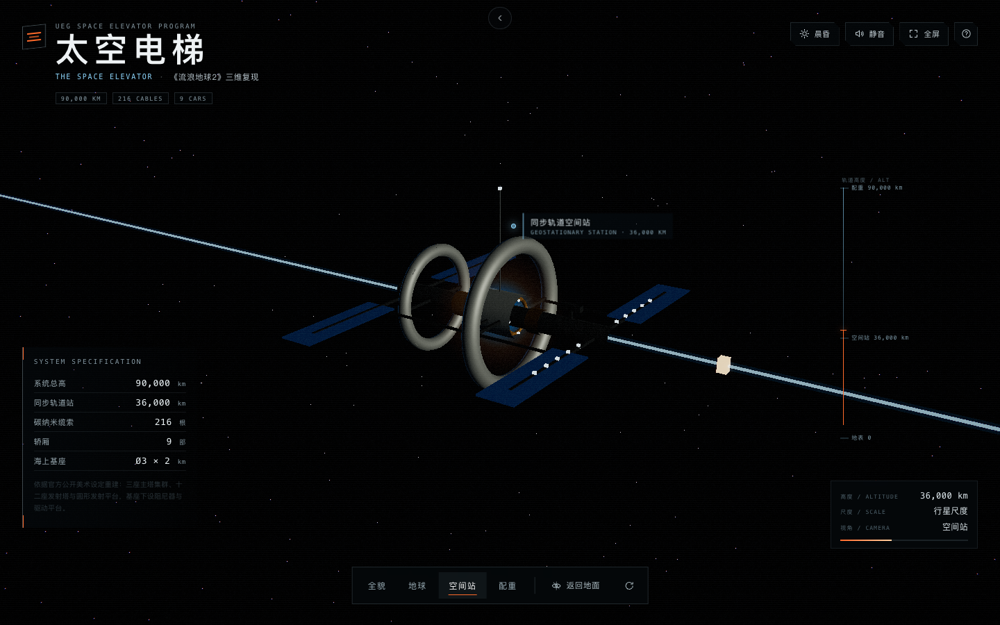
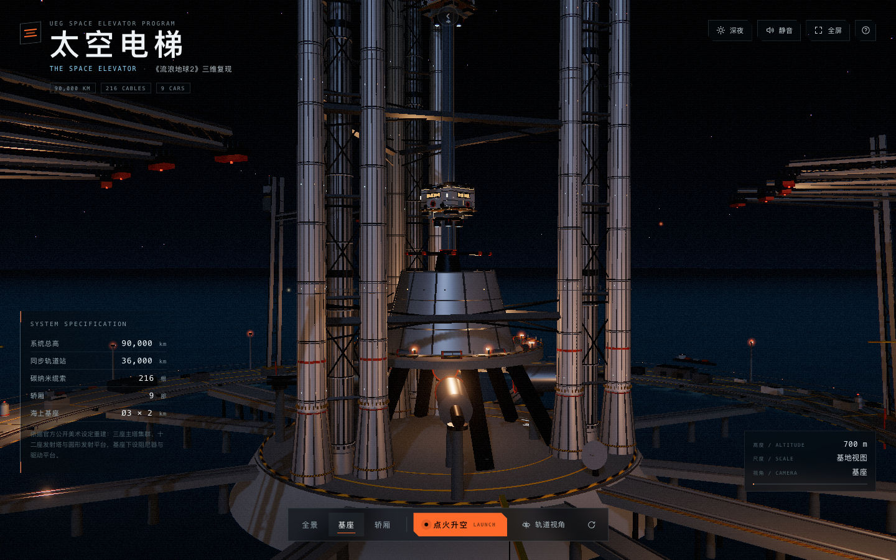

# 太空电梯 · The Space Elevator

> 电影《流浪地球2》太空电梯的三维复现。  
> A fan-made 3D reconstruction of the Space Elevator from *The Wandering Earth II*.

> 本项目是「同一 Prompt × 不同 Agent+Model」实验合集的成员之一。
> 实验环境：**OpenCode + DeepSeek V4.1 Flash 1017**。合集首页位于仓库根目录，构建后从首页进入本项目体验。

## 效果预览

晨昏与深夜双光照主题、基地 / 轨道双尺度场景，支持点火升空跟拍：

| 晨昏 · 基地全景 | 基座 · 三主塔集群 |
| :---: | :---: |
|  |  |
| **轿厢近景** | **轨道尺度 · 空间站** |
|  |  |
| **深夜主题 · 主塔灯光** | |
|  | |

这是一个完全运行在浏览器里的实时 3D 场景：从赤道海上的 3 km 圆形基座、三座 2 km 主塔、十二座发射塔和 216 根缆索，到 36,000 km 的同步轨道站与 90,000 km 的配重，都可以通过鼠标或触屏自由旋转、缩放查看。

本项目是非商业同人作品，不是电影官方产品。美术参考与版权说明见 [`docs/ART-REFERENCE.md`](docs/ART-REFERENCE.md)。

## 特性

- **双场景尺度**
  - 基地场景：以米为单位的海上基座，包含 3 座主塔集群、12 座发射塔、圆形发射平台、阻尼器、栈桥、补给船与 9 部轿厢。
  - 轨道场景：地球半径归一化为 1，按真实比例呈现 36,000 km 同步轨道站、90,000 km 配重和整条缆索。
- **电影感渲染**：PBR 金属材质、程序化天空/海面/大气 shader、云层、Bloom、胶片颗粒、暗角与轻微色差。
- **完整交互**：鼠标拖动旋转、滚轮缩放、右键平移；触屏单指旋转、双指捏合缩放、双指拖动平移。
- **镜头叙事**：全景 / 基座 / 轿厢，以及全貌 / 地球 / 空间站 / 配重四组机位；支持 2.2–2.4 s 平滑过渡。
- **点火升空**：跟随 02 号轿厢沿缆索爬升，带发动机点火、追车镜头与高度/速度遥测；再次点击可回收。
- **晨昏 / 深夜**：切换太阳方向、雾色、天空、海面、曝光与夜间点光源。
- **移动端适配**：竖屏自动拉远基地机位；轨道场景在竖屏下把缆索旋转为纵向，地球在下、配重在上的“标尺式”构图。
- **可读的 HUD**：规格表、轨道高度标尺、空间站/配重/基座标签、实时相机与尺度信息；标签会自动避让屏幕边缘。
- **程序化环境音**：可选的低频结构嗡鸣与海风噪声（Web Audio，无外部音频文件）。

## 快速开始

要求 Node.js 20+。

```bash
npm install
npm run dev        # 开发服务器，默认 http://localhost:5173
npm run build      # 产出 dist/
npm run preview    # 预览构建产物，默认 http://localhost:4173
```

类型检查与构建：

```bash
npm run typecheck
npm run build
```

## 操作

| 操作 | 桌面 | 触屏 |
| --- | --- | --- |
| 旋转视角 | 鼠标左键拖动 | 单指滑动 |
| 缩放 | 滚轮 | 双指捏合 |
| 平移 | 鼠标右键拖动 | 双指拖动 |
| 切换机位 | 底部“全景 / 基座 / 轿厢”或“全貌 / 地球 / 空间站 / 配重” | 同左 |
| 点火升空 | 底部橙色“点火升空”按钮 | 同左 |
| 昼夜切换 | 右上角“晨昏 / 深夜” | 同左 |
| 进入轨道视角 | 底部“轨道视角” | 同左 |
| 自动环绕 | 底部圆形箭头按钮 | 同左 |
| 全屏 | 右上角全屏按钮 | 同左 |
| 操作说明 | 右上角问号按钮 | 同左 |
| 环境音 | 右上角声音按钮 | 同左 |

## 项目结构

```text
.
├── index.html                  # HUD / 控件 / 模态框结构
├── src/
│   ├── main.ts                 # 启动、双场景切换、渲染循环、遥测、调试接口
│   ├── style.css               # 全部 UI 样式与移动端断点
│   ├── core/
│   │   └── AmbientAudio.ts     # 程序化环境音
│   ├── model/
│   │   └── SpaceElevatorBase.ts# 基座、主塔、发射塔、缆索、轿厢、船只
│   ├── scene/
│   │   ├── BaseScene.ts        # 基地相机、机位补间、升空追车、主题
│   │   ├── OrbitalScene.ts     # 地球、空间站、配重、轨道相机与标签
│   │   ├── Environment.ts      # 天空/海面/云/光照/雾/夜间灯
│   │   ├── Post.ts             # Bloom + 胶片颗粒/暗角/色差
│   │   ├── materials.ts        # 材质与昼夜主题
│   │   └── util.ts             # MeshBuilder、随机数、纹理、缓动
│   ├── ui/
│   │   └── Hud.ts              # HUD、标签避让、预设与按钮绑定
│   └── assets/textures/        # 地球昼/夜/高光/云层贴图
├── docs/
│   ├── DESIGN.md               # 技术方案与实现细节
│   ├── ART-REFERENCE.md        # 官方公开美术对照与素材来源
│   └── reference/official-art/ # 公开美术参考图
└── scripts/                    # Playwright 截图 / 交互 / 移动端测试
```

> 历史测试截图产物不迁入合集；需要时运行合集根目录的 `npm run thumbs` 统一重新生成。

## 测试

构建产物运行在 `http://127.0.0.1:4173/`（先运行 `npm run preview`，或通过 `APP_URL` 指定）时，可执行：

```bash
# 桌面端截图：全景、基座、轿厢、夜景、升空、轨道四机位
node scripts/capture.mjs

# 桌面端交互：拖动旋转、滚轮缩放、机位补间、昼夜、升空、轨道切换、标签/标尺
node scripts/test-interactions.mjs

# 移动端 390×844：布局不溢出、单指旋转、双指捏合、机位、昼夜、轨道模式、标签不出界
node scripts/test-mobile.mjs
```

截图输出到 `artifacts/`。测试使用 Playwright + SwiftShader，在无头环境下帧率较低，因此涉及时间推进的断言会等待较长时间；真实浏览器中的动画按 60 fps 运行。

## 构建与部署

`vite.config.ts` 使用 `base: './'`，因此 `dist/` 可以直接放到任意静态托管的任意子路径下，不会出现资源 404。

```bash
npm run build
# 将 dist/ 上传到静态托管即可
```

地球贴图通过 `new URL('./assets/textures/...', import.meta.url)` 引入，Vite 会把它们一起打包进 `dist/assets/`，不需要额外的运行时资源目录。

## 素材与版权

- **代码与程序化模型**：本项目原创实现（Three.js / Vite / TypeScript）。
- **电影美术参考**：来自电影《流浪地球2》官方公开发布的美术设定图，仅用于非商业的学习、研究与评论。影片名称、角色、美术设定及相关视觉元素的著作权归电影出品方及原设计团队所有。
- **地球贴图**：NASA / Three.js 示例资源（`earth_atmos_2048.jpg`、`earth_lights_2048.png`、`earth_specular_2048.jpg`、`earth_clouds_1024.png`），遵循其原始授权。
- **商业出版的《流浪地球2电影艺术设定集》**：受版权保护，本项目**未**下载、收录或分发该书内容。`docs/reference/official-art/` 中仅包含官方在公开渠道发布的美术图，用于建模对照。

本项目与电影《流浪地球2》的出品方、制作方无隶属关系。若相关权利方认为某张参考图的使用不适当，请联系删除。

## 已知取舍

- 基地场景中的缆索是 **26 km 的局部视觉段**（`CABLE_TOP = 26000`），用于在基座尺度下看清缆索与轿厢；完整的 90,000 km 比例在轨道场景中呈现。
- 12 座发射塔、补给船、平台设备等为程序化风格化重建，细节密度受实时性能限制，并非电影资产的逐件复刻。
- 轨道场景中地球半径归一化为 1，空间站位于 `1 + 36000/6371 ≈ 6.65`，配重位于 `1 + 90000/6371 ≈ 15.13`；标签中的公里数仍为真实设定值。
- 无头测试环境使用 SwiftShader，截图中的 Bloom/抗锯齿与真实 GPU 会略有差异。
