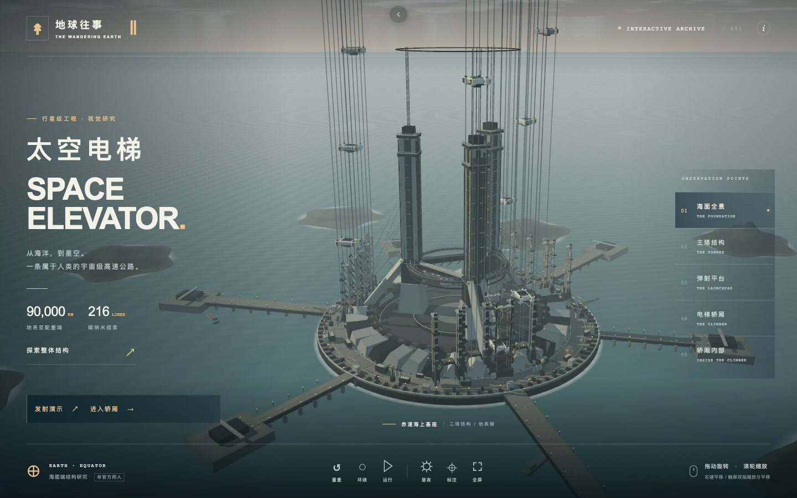
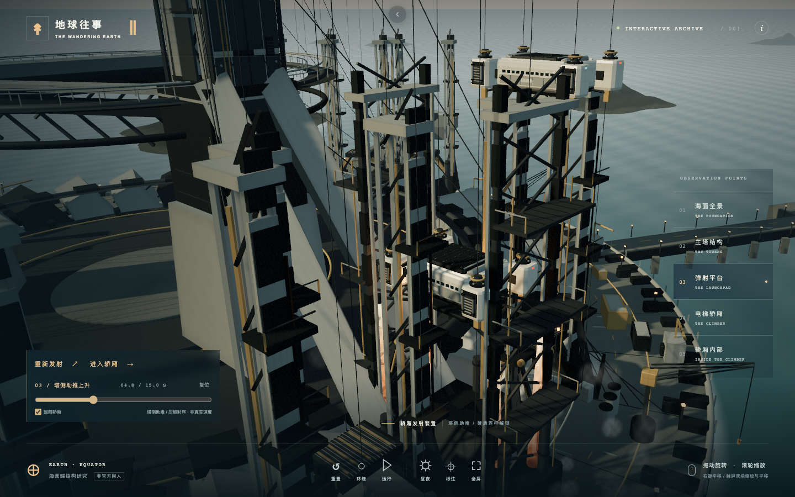
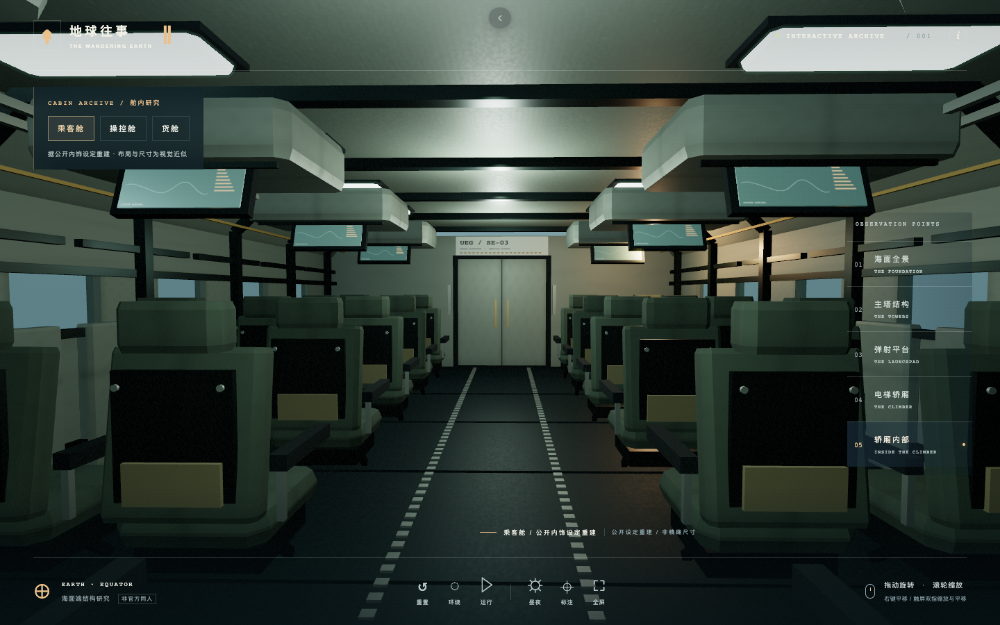
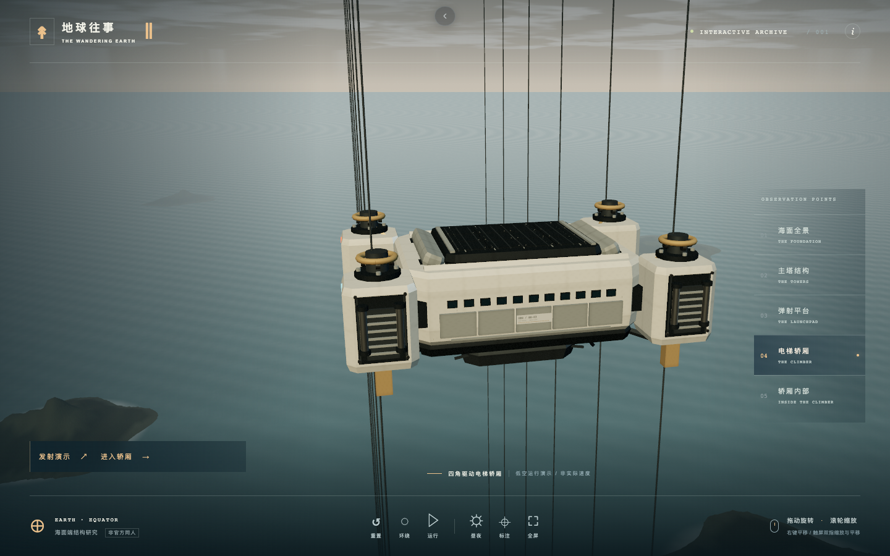
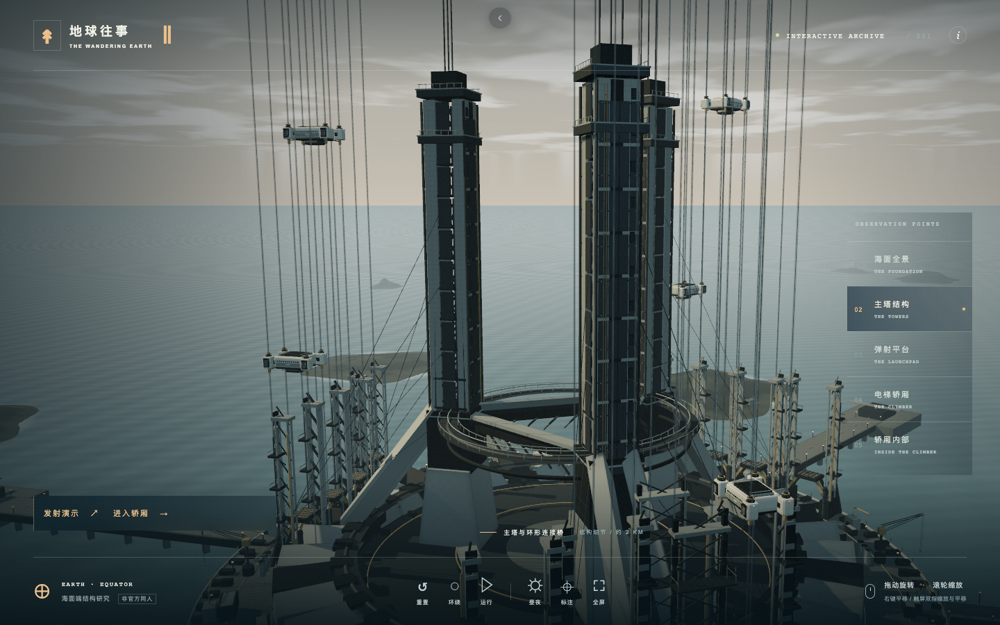
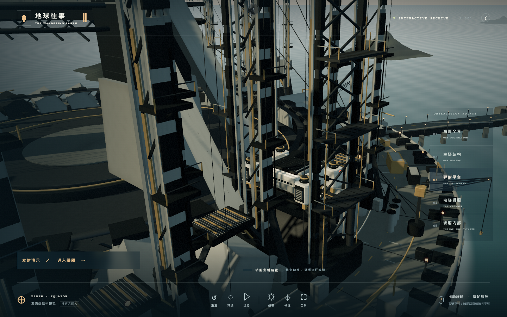
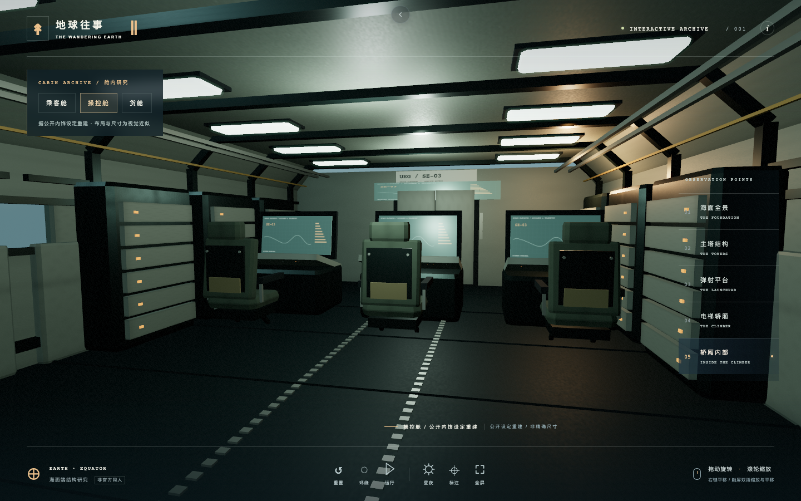
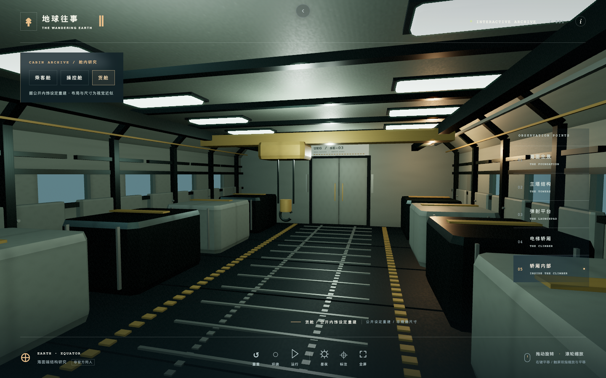
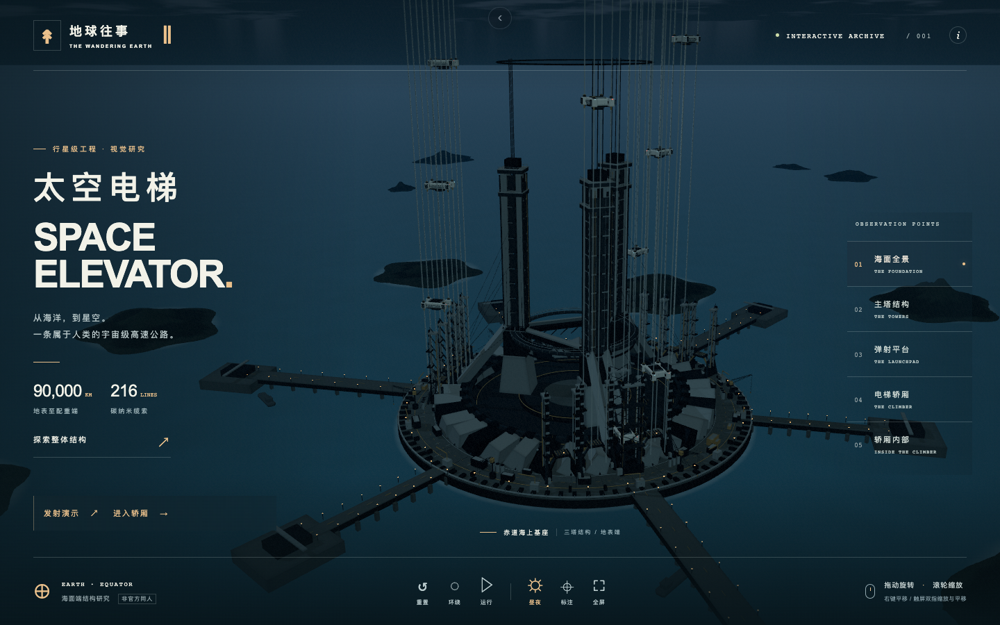
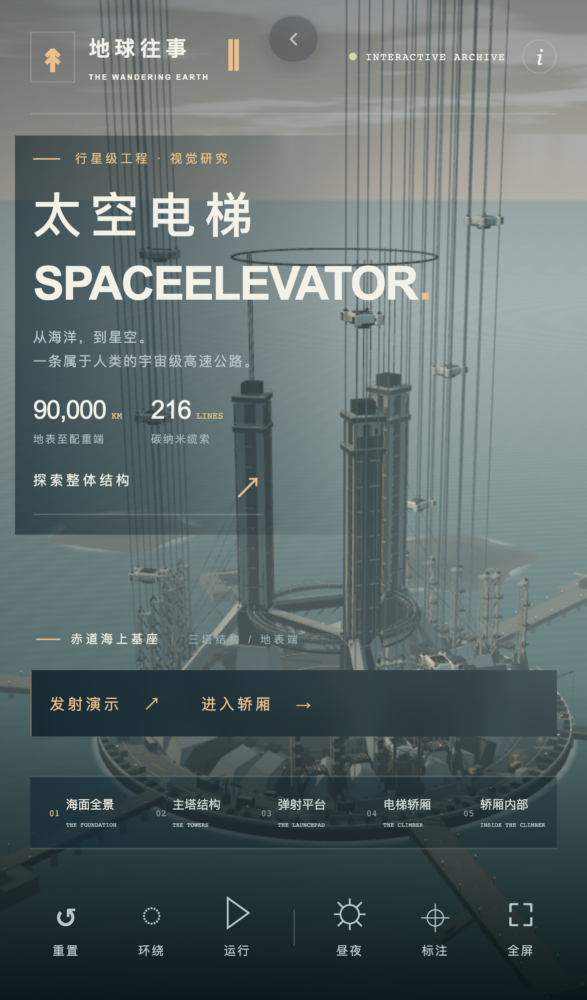

# 太空电梯 · SPACE ELEVATOR

基于《流浪地球2》公开美术设定，独立构建的 Web 3D 海面端太空电梯研究。**非官方、非商业同人作品**，不是电影原始模型。

本项目是「同一 Prompt × 不同 Agent+Model」实验合集的成员，实验组合为 **OpenCode × GPT-6-1-Sol**。
从仓库根目录运行 `npm run build`、`npm run serve`，即可在 <http://127.0.0.1:4177/> 的首页进入本作品；
根构建产物的页面顶部提供返回合集首页的按钮。



## 本地运行

需要 Node.js 22+、npm，以及支持 WebGL 2 的现代浏览器。

```bash
npm install --registry=https://registry.npmjs.org/
npm run dev
```

开发地址：<http://127.0.0.1:5176/>。

生产构建与本地预览：

```bash
npm run build
npm run preview
```

预览地址：<http://127.0.0.1:4176/>。服务仅监听本机，无需账户、后端或外部 CDN。`dist/` 可独立静态托管，资源路径全部相对；合集返回按钮由根构建器注入，本项目不手写。

## 观看方式

| 操作 | 鼠标 | 触屏 |
| --- | --- | --- |
| 旋转 | 左键拖动 | 单指拖动 |
| 缩放 | 滚轮 | 双指捏合/张开 |
| 平移 | 右键拖动 | 双指同向拖动 |

- 五个预设视角：海面全景、主塔结构、弹射平台、电梯轿厢、轿厢内部。
- 点击「发射演示」：蓄压检查 → 连杆解锁 → 塔侧助推 → 缆索爬升。支持工具栏暂停/继续、拖动进度、跟随开关、重播与复位；不会自动发射。
- 点击「进入轿厢」或第五机位，切换乘客舱、操控舱和货舱；沿用鼠标/触屏观看，内饰相机限制在舱内。
- 工具栏：当前视角重置、自动环绕、轿厢运行/暂停、昼夜、结构标注、全屏。
- 结构档案解释基座、缆索、轿厢、同步轨道空间站与配重，并标注真实设定中的距离；示意图不按比例。
- Canvas 获得键盘焦点后可用 `R` 重置、`+` / `-` 缩放；减少动态偏好默认暂停轿厢。
- 固定截图可用 URL 参数：`?view=climber&motion=0`、`?view=tower&motion=0`、`?night=1&motion=0`。可选 `view` 为 `overview/tower/launch/climber/interior`。
- 内饰直达：`?view=interior&cabin=passenger&motion=0`，`cabin` 可选 `passenger/control/cargo`；发射定格：`?view=launch&launch=4.8&motion=0`，`launch` 是 0–15 的模拟秒数。

## 还原范围

三根主塔、十二组弹射塔、海上圆形基座、环形连接桥、放射栈桥、九部白色四角驱动轿厢，以及 216 根可数缆索。结构说明据电影官方账号公开文章；面板、钢桁架、岛礁与环境均为自行程序化重建的近似。

重点是约 3 km 直径、2 km 高的海面基座。**不宣称等比例重建了 90,000 km 全长**，也不包含电影完整空间站、配重、行星发动机或人物。内饰据公开摘页的座椅、控制台和货舱吊机重建，但布局、数量与尺寸是视觉近似。内外场景采用不同观察尺度；15 秒为压缩的模拟时序，不是实际发射速度、墙钟计时或工程仿真。模型与材质继续细化，仍非电影原始资产或电影级精度。

## 本次增强：发射、三舱内饰与表面精度

在此前三轮版本上，按第三次用户提交继续增强，不将它混算为原始 Prompt 单轮成果：

- **发射机构**：独立可动连杆、滑台、塔侧助推喷焰/烟雾；实际轿厢沿对应缆索通道上升，修正原通道与主塔斜撑穿插。
- **三舱内饰**：24 座乘客舱、3 席操控舱、8 货箱与顶置吊机的货舱；补上约束带、舱门、检修板、顶灯、管线、显示屏和地板标记。这些数量属于本项目布局，不是电影设定断言。
- **机械精度**：导索滚轮、驱动活塞/软管、窗框、屋顶嵌板、标识、塔身分层面板、码头起重机、压力罐和基座管线，保持重复件合并/实例化。
- **材质与成像**：白色轿厢 1024²、主要工业表面 512² 的独立颜色/法线/金属粗糙度贴图；天空环境反射、岛礁顶点色、海面调整，HalfFloat 离屏成像、4× MSAA、轻量高光溢出与固定颗粒。

参考对照、实际修正和剩余取舍见 [docs/enhancements.md](docs/enhancements.md)。**4176 独立预览与 4177 合集均包含本次增强**，统一缩略图与九个桌面机位效果图已更新。直接预览：<http://127.0.0.1:4177/projects/OpenCode/GPT-6-1-Sol/>。本地最终验收见 [docs/testing.md](docs/testing.md) 末节；推送后沿用根仓库的 GitHub Pages 发布流程。




## 用户反馈后的三轮改进

第二次用户提交指出首版粗糙后，在原项目上完成恰好三轮自主视觉迭代：

1. **结构**：重排三塔比例与通道，增加梯形裙座/斜撑、连续蒙皮、较高双侧弹射塔，重建折面轿厢与四角外伸舱。
2. **细节与渲染**：拼缝、紧固件、管线、维修平台、双段液压、驱动舱凹面/百叶、屋顶与底盘，新增四类程序表面、反射环境与多尺度水面。
3. **可读性与预算**：修正被壳体遮挡的短窗、降低驱动舱比例、屋顶进气/侧门、细线透明度和四机位，检查移动端与实际绘制成本。

逐轮差异、实质修改、实际截图对照和不足见 [docs/iterations.md](docs/iterations.md)。三轮版曾完成独立与合集验收，作为历史保留；本次增强前的效果图及报告保存在 `.runtime/launch-interior-baseline/`。下方为当前自有场景截图，不是参考图。



<details>
<summary>更多视角</summary>








</details>

## 资料与版权

已研究官方账号文章与媒体公开展示的九张设定长图。**未找到获授权的完整商业美术集免费 PDF**；未下载盗版。公开摘页仅缓存至 Git 忽略的 `.runtime/references/`，不进入 `docs/`、源码或网站产物。可公开的来源、获取结果和研究方案见 [docs/research.md](docs/research.md)。

电影片名及美术设定相关权利归各自权利人所有。本项目与电影出品方无隶属或授权关系。代码为 MIT；该许可不授予电影或参考图片的任何权利。

## 测试

```bash
npm test
npm run build
npm run preview
```

另一个终端执行：

```bash
npm run test:browser
npm audit --registry=https://registry.npmjs.org/
```

浏览器测试默认使用本机 Chrome。没有 Chrome 时，可通过 `BROWSER_EXECUTABLE` 环境变量指定已安装 Chromium 路径。测试采用 Playwright + 软件 WebGL，在 `.runtime/` 输出 JSON 结果、在 `docs/screenshots/` 更新自有场景效果图；它不是生产运行依赖。触屏是 CDP 模拟，不代替真机和 Safari 验收。

本次 8 项单测、独立预览与根产物各 36 项浏览器检查通过；合集六作品的根路径/项目页子路径、三舱/发射直达与返回导航复核通过。依赖审计 0 漏洞，源码/产物公开审计 0 命中。全景约 201 calls / 340,202 triangles，计入阴影和离屏成像；三舱分别约 41/43/39 calls、17,254/9,622/9,202 triangles，不宣称真机帧率。主包约 526.52 kB，标准大包提示保留；未升级依赖大版本。真实最终验收与历史见 [docs/testing.md](docs/testing.md)。

## 工程

- `src/model.js`：程序化电梯、批量钢构、合并轿厢几何。
- `src/environment.js`：程序海面/天空、灯光与岛礁。
- `src/geometry.js`、`src/climber.js`：折角/倒角几何与独立轿厢。
- `src/details.js`、`src/surfaces.js`：工业细节、程序表面纹理。
- `src/launch.js`：确定性发射时序、控制器、动态连杆与塔侧助推装置。
- `src/interior.js`：三舱建模、独立照明与区域切换；首次进入时才创建模型。
- `src/cinema.js`：HDR 离屏渲染、4× MSAA 与轻量成像。
- `src/main.js`：渲染、OrbitControls、镜头、交互与标注。
- `src/style.css`：桌面与移动档案式界面。
- `scripts/browser-test.mjs`：生产浏览器与子路径测试。
- `docs/`：研究、测试及自有场景截图，不打包到 `dist/`。

依赖许可：Three.js / Vite / pngjs 为 MIT，Playwright 为 Apache-2.0。依赖安装固定使用公共 npm registry，项目无私有服务。

初次交付使用原始 Prompt 的一次用户提交，从零实现；随后合集完成接入。第二次用户提交要求三轮自主迭代；第三次提交新增发射、内饰与精度提升。未使用其他实验源码或设计。完整阶段记录见 [docs/experiment.md](docs/experiment.md)。
