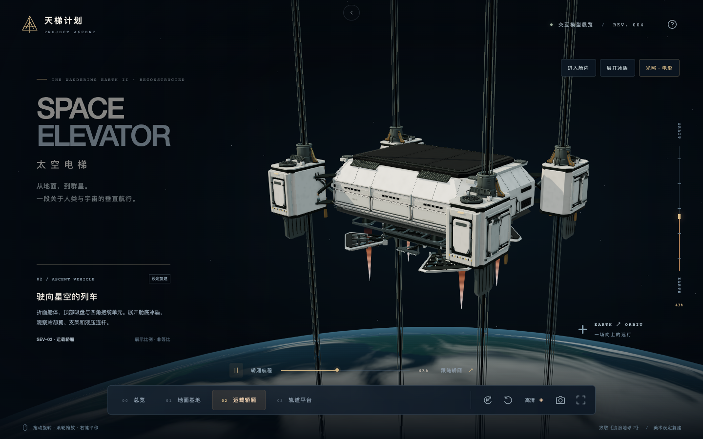
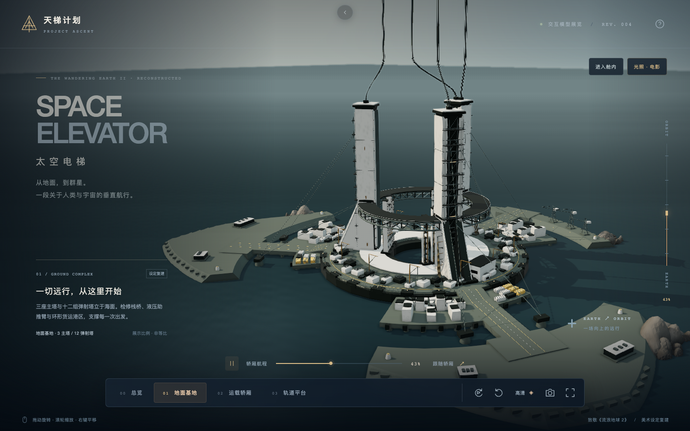
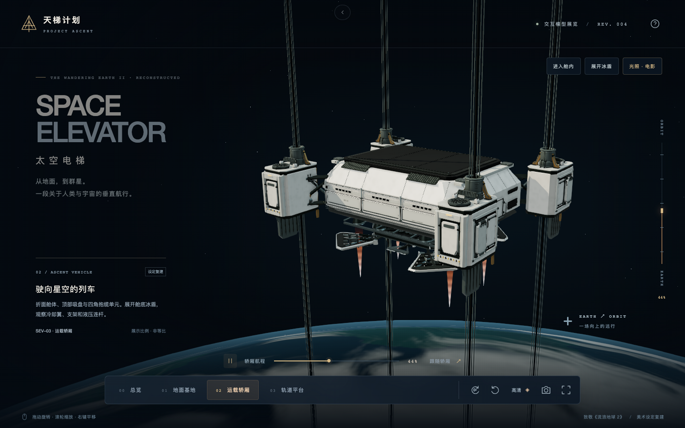
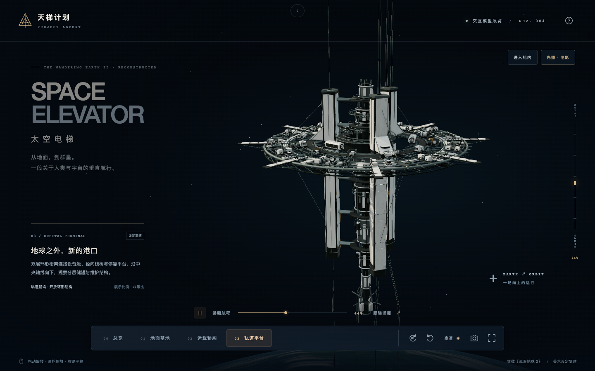

# 天梯计划 · PROJECT ASCENT

参照《流浪地球 2》公开美术设定重建的太空电梯 Web 3D 展台（Revision 04）。展示高度经过压缩，隐蔽结构与细节为近似，并非电影原始制作模型。

这是非官方的原创概念展示，与电影出品方无隶属或授权关系；片名、设定及相关权利归其各自权利人所有。

> 本项目是「同一 Prompt × 不同 Agent+Model」实验合集的成员之一。
> 实验环境：**Trae + GPT 6 Astra**。合集首页位于仓库根目录，由根目录统一构建（本地预览 + GitHub Pages 公开发布）。

## 效果预览

四个展台视角 + 可展开冰盾 / 进入舱内，画面沿航程滑块在地面与轨道间过渡：

| 总览 · 压缩高度全系统 | 地面基地 |
| :---: | :---: |
|  |  |
| **运载轿厢 SEV-03** | **轨道平台** |
|  |  |

## 本地运行

需要 Node.js 22.12+。

```bash
npm ci
npm run dev
```

生产构建与预览：

```bash
npm run build
npm run serve
```

默认仅监听 `127.0.0.1:4177`；可用 `PORT=xxxx npm run serve` 改端口。`dist/` 可独立部署到支持静态文件的托管服务。

## 操作

- 鼠标左键拖动旋转、滚轮缩放、右键平移。
- 触屏单指旋转、双指捏合缩放、双指平移。
- 底部按钮或部件标记切换总览、地面基地、运载轿厢、轨道平台。
- 航程滑块调整轿厢位置；支持播放 / 暂停、跟随和自动环绕。
- 支持流畅 / 高清画质、保存模型截图、全屏和操作说明。
- 右上角切换电影 / 结构光照；高清电影模式启用接触遮蔽和轻微泛光，流畅模式直接渲染。
- 轿厢视角可展开 / 收拢冰盾；展开自动转至舱底视角，可继续拖动观察冷却翼。
- 右上角“进入舱内”打开客舱，可切换客舱过道、乘员座位、操控舱与结构剖面。“返回舱外”回到运载轿厢。
- 舱内拖动环顾；前三个位置固定观察点，剖面支持旋转、缩放和平移。舱内相机随轿厢航程移动。
- 键盘 1–4 切换外部视角、5 进入舱内、空格播放 / 暂停、R 重置（输入控件聚焦时不接管快捷键）。

## 代码

- `src/model.ts`：基座、缆索、轿厢、轨道平台、地球与星空。
- `src/detail.ts`：弹射塔、舱体面板、抱缆机构、检修设备和轨道服务层。
- `src/station-layout.ts`：基地与轨道站塔体、护板、附件共用的三向坐标基准。
- `src/station-equipment.ts`：轨道环分组设备、承力底座、法兰端口及步道下绕管线。
- `src/cable-layout.ts`：四组五股导缆的端部映射、运行段与独立接入点。
- `src/harbor-layout.ts`：港区道路避让、入港坡面标高及三段独立岸线轮廓。
- `src/cabin.ts`：42 个乘员座位与 2 个操控席、压力舱、管线与灯具、仪表台、四个内舱观察位置。
- `src/rendering.ts`：画质管线、接触遮蔽、泛光、SMAA 抗锯齿和海上天空。
- `src/main.ts`：相机与交互、动画、画质、截图及错误降级。
- `src/style.css` 与 `index.html`：响应式展台。
- `scripts/serve.mjs`：只读静态服务，限定发布目录，提供 `/healthz`。
- `scripts/service.mjs`：独立后台服务的 start/status/stop；停止前核对进程命令行，避免误杀。
- `scripts/verify.mjs`：Playwright 浏览器烟测，输出在系统临时目录的 `ascent-verification-v4/`，具体路径打印于报告。安装浏览器后执行 `node scripts/run-verification.mjs`，由 runner 启停测试服务。包含四个内舱位置的桌面/移动端截图与六张跟随连续帧。
- `scripts/verify-rendering.mjs`：高分屏黑块回归。执行 `node scripts/run-verification.mjs verify-rendering.mjs`，检查 71% 航程的连续帧、车壳亮度、画质/内舱/窗口切换，并收集 GPU warning；结果位于系统临时目录的 `ascent-rendering-verification/`。

## 验证记录

2026-10-20，Revision 04：TypeScript 与 Vite 构建通过；Chromium 软件 WebGL 下 65 项检查通过，覆盖桌面和 393×852 触屏仿真、动画暂停和跟随、冰盾、电影 / 结构光照、重复画质切换、左右键拖动、双指缩放和平移、全屏、键盘、截图、上下文丢失、WebGL 不可用和减少动态效果。新增四个舱内位置、剖面缩放、固定位置环顾、舱内航程跟随、返回/重置、内舱截图与连续帧相机/阴影稳定性检查。没有页面 JavaScript 或着色器错误。

这是浏览器自动化与触摸事件仿真，尚未在实体 iPhone 或 Android 手机测量帧率和发热。移动端默认低像素比并关闭实时阴影和后期处理。高清电影模式下，固定轿厢视角报告约 46 万次三角形提交、193 次绘制调用；客舱过道约 48 万次提交、160 次调用。它们包含阴影和后期等多次渲染，并非模型的独立面数。三角面与调用随观察部件变化，以当次 verification.json 为准。

## 素材来源

模型几何、金属面板纹理、标识、地球和云层贴图均由本项目代码生成。可运行以下命令从确定性算法重新生成贴图：

```bash
npm run generate:textures
```

网页发布包不包含电影原始模型或美术参考图。采集自公开网页的 38 个公开美术参考图文件保存在 `references/private/`，作为非商业同人研究档案随合集仓库公开，但不进入网页产物，来源及图版对应关系见 [references/README.md](references/README.md)。Three.js 使用 MIT 许可，详见 `THIRD_PARTY_NOTICES.md`。本项目尚未达到电影制作资产的精度。

## 第三版细化内容

- 轿厢：顶部吸盘分块、肩部格栅、舱门锁扣、压力滚轮、冷却风扇、细分倒角与四片可动舱底冰盾；按图版纠正“顶部热盾”的旧称。
- 基座：新增十二组弹射塔、液压助推臂、主塔检修平台与爬梯、港区集装箱、桥面与环形甲板桁架。
- 缆索：更细的平行束线和表面分缕，保留展示用四组主导缆索。
- 轨道端：多层环形服务结构、更密集的设备箱、储罐、管线与外伸栈桥。
- 材质与环境：独立粗糙度纹理、冷暖照明、局部接触遮蔽、轻微泛光、分层云系、海上天空与距离雾。

几何批量合并以控制绘制开销。造型依据与未覆盖的还原范围详见参考目录说明；本轮没有加入新的第三方依赖。

## 第四版细化与稳定性

- 乘员舱：双侧排座、四点式安全带、头枕、脚托、后背设备板与折叠托板；中央过道、安全引导线、地板安装轨、设备柜、密封后门、前端操控区、仪表与局部照明。
- 舱外：补充端部检修舱门的密封框、铰链、登舱扶手与踏步，抱缆单元的液压管路与接头；调整侧窗压条的层次。
- 深度：抬高外部相机近裁面，内舱单独使用 `.04–100` 裁剪范围；移开侧窗与通风口的重叠表面，删除主塔顶部重复横梁和缆索的亚像素条纹。
- 相机：切换视角前清除平移/旋转惯性，修复“右键平移 → 切换视角 → 开启跟随”后目标仍继续偏移的问题；保留当前画面作为过渡起点。
- 阴影与后期：阴影投影跟随观察部件，避免相机平移改变投影中心；SSAO 法线阶段排除透明外壳/云层与喷流等着色器几何；提高 AO 采样分辨率并加入 SMAA。

这些修改针对深度竞争、阴影游动和细线锯齿。此前固定跟随样本未复现明显车壳闪烁，不能从该样本推导修复百分比，也不能保证所有硬件和角度完全消除闪烁。软件 WebGL 的验证用于交互和画面回归，不代表实体 GPU 的帧率与稳定性。

## 4.0.1 黑块与闪烁修复

用户反馈的黑色模型轮廓促使本次验证增加 GPU warning 捕获。修复前的高分屏运行记录出现 83 条 `GL_INVALID_OPERATION: glBlitFramebuffer: Depth/stencil buffer format combination not allowed for blit.`。此前只收集 `console.error` 的检查漏掉了这类警告。

- 移除后期颜色缓冲与 SSAO 法线缓冲的 MSAA；保留最终 SMAA 抗锯齿，避免后期原地混合依赖已失效的多重采样颜色数据。
- SSAO 深度纹理改为匹配深度附件的 `DepthFormat` / `UnsignedIntType`，消除深度与模板格式不匹配的拷贝。
- 保留电影光照、环境遮蔽、泛光和内舱，未以关闭这些功能代替修复。

2026-10-20 验证：构建和 65 项交互检查通过；DPR 2 的专项测试采集 19 张画面、通过 18 项断言，包含 8 张连续跟随画面、车壳黑块/亮度检测、画质和舱内外切换、窗口缩放。GPU 警告与 JavaScript 错误为 0。Apple M4 Pro / ANGLE Metal 的 71% 航程检查也返回 WebGL 错误码 0，并完成画布像素读取；未据此宣称覆盖所有显卡或长时间运行。

## 4.1.0 设定图迭代

2026-10-21，从 4.0.1 开始逐轮对照公开图版。差异基线、每轮修改、复核结果与下一步均保存在 [iteration-reports/](iteration-reports/round-00.md)；固定视角模型截图在 `previews/iterations/`，含参考图的对照拼图只留在 `references/private/iterations/`。

- 轿厢：开放叉臂、大门板分区、分组观察孔、三块薄顶板、凹陷夹持舱、灰色导向翼。
- 基地：宽楔形塔脚、厚环形连桥、连续塔冠导缆、港区分段承台、开放外堤、连续桥端与入港坡道。
- 轨道站：径向管路/服务舱分层、缩短上塔并延长维护段、开放中央平台、宽塔脚及安装盖。
- 内舱：暂按设定图可见区域采用 5+1 横向排座、42 乘员席与 2 操控席、偏置过道、降低设备梁、开放桥架和侧肩灯、多级倾斜控制台；该座位总数不是官方配置。
- 冰盾：八边形基架、梯形冷却翼、下层制动架、伸缩支杆，展开时总成下移并联动翻转。

最新完成 [第 30 轮](iteration-reports/round-30.md)：轨道站两塔之间、内步道以内加入三组不同长短与高度的机械舱，带真实承梁支脚、鞍座、端盖和短管总成。24 项内圈、12 项切向、36 项径向设备检查，以及 65 项交互和 18 项高分屏检查通过；十组局部前后镜头与十固定视角状态一致，页面/GPU 错误 0。绘制调用不变，轨道站三角形提交从 905,188 增至 929,332。下一步按 [第 31 轮](iteration-reports/round-31.md)改善基地岩体的重复轮廓与单一材质。轨道设备组合、冰盾中央机构、冠部接口及舱内材质差异继续保留，尚未证明 90% 还原或方案已收敛。
- 材质：删除规则接缝贴图，修正放样面 UV，分离喷漆微纹理、粗糙度和金属；面板接缝由几何定义。

迭代保留 4.0.1 单采样后期、匹配深度格式与最终 SMAA。详细验证以各轮 JSON 和报告为准；当前迭代没有建立新的 Safari / Metal 画面覆盖。已处理的差异数量不是模型相似度，尚无客观“90% 还原”测量结论。展台依然采用压缩高度、单轿厢及示意地球。
